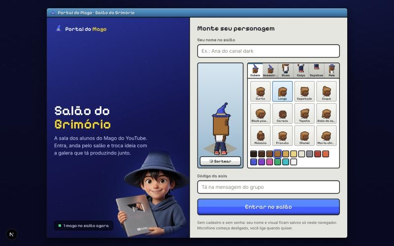
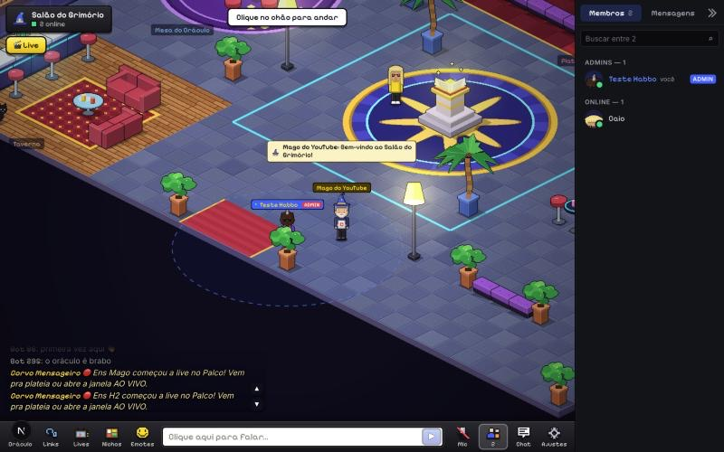
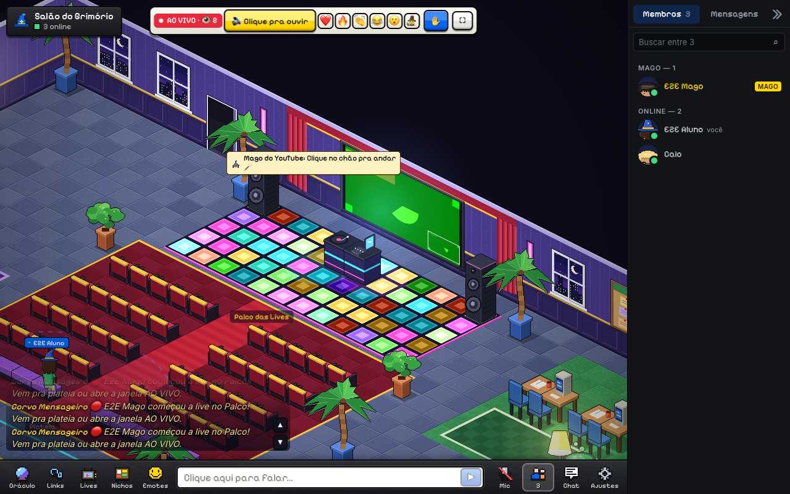

# Portal do Mago

Comunidade online dos alunos do Mago do YouTube: o **Salão do Grimório**, uma sala isométrica em pixel art onde cada aluno tem um boneco, anda, conversa no chat, manda emotes e fala por voz com quem está perto. Dentro do salão:

- **Palco das Lives**: o Mago transmite câmera e tela para a sala inteira (até ~300 pessoas), chama alunos para o palco, fixa avisos. A live é **gravada sozinha**.
- **Lives anteriores** (`/lives`): as gravações, com player que abre no minuto certo.
- **Oráculo** (`/oraculo`): responde dúvidas com base nas aulas do curso e nas lives gravadas, dizendo em qual aula e em que minuto aquilo foi dito.
- **Mural de links** (`/links`), **Sala de TV**, mensagens diretas, moderação (mutar, expulsar, avisos).
- **Acesso por compra na Kiwify**: o aluno entra com o e-mail da compra (código de 6 dígitos por e-mail). Quem pede reembolso ou cancela perde o acesso sozinho.

## Como colocar no ar

Tudo está em **[HANDOFF.md](HANDOFF.md)**, passo a passo. Se você usa um agente de código (Claude Code, Codex), abra este repositório nele e peça: *"me guie no setup do HANDOFF.md"*. O agente segue o [AGENTS.md](AGENTS.md).

Depois de no ar:
- [docs/GUIA-DO-MAGO.md](docs/GUIA-DO-MAGO.md): como fazer uma live.
- [docs/CHECKLIST-DA-LIVE.md](docs/CHECKLIST-DA-LIVE.md): checklist antes, durante e depois de cada live.
- [docs/KIWIFY.md](docs/KIWIFY.md): ligar o acesso pela compra.
- [docs/TECNICO.md](docs/TECNICO.md): arquitetura, endpoints, moderação por HTTP, teste de carga.

## Peças

| Peça | Onde roda | Pasta |
|---|---|---|
| Site (Next.js 16) | Vercel | `app/`, `components/`, `lib/` |
| Tempo real (salas, live, gravações) | Cloudflare Workers + Durable Objects | `realtime/` |
| Vídeo da live | Cloudflare Realtime (SFU + TURN) | via `realtime/` |
| Gravações e transcrição | Cloudflare R2 + Workers AI (Whisper) | via `realtime/` |
| Banco (Oráculo, membros, links, lives) | Postgres com pgvector (Supabase) | `db/`, `cli/` |
| Respostas do Oráculo | Anthropic (Claude Haiku) | `lib/oraculo/` |
| E-mail de login | Resend | `lib/portal/mail.ts` |

O conteúdo do curso (transcrições das aulas) **não está neste repositório**: é entregue em privado e carregado no banco (HANDOFF.md, passo 5).

---

Código cedido ao Mago do YouTube para uso na própria comunidade. Todos os direitos reservados a 33WEB. Veja [LICENSE](LICENSE).
